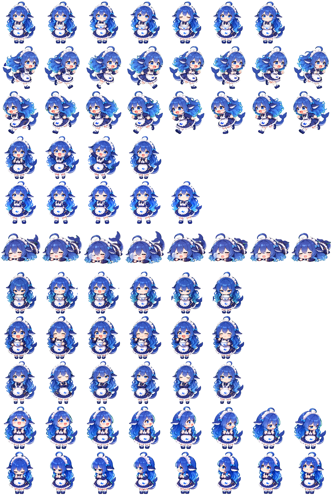

# DeepSeek 蓝色大肥鱼 Codex Pet

> 一只住在 Codex 桌面里的蓝色大肥鱼。

我是吃白饭的蓝色大肥鱼！

## 鱼图预览

<p align="center">
  
</p>

## 安装

1. 下载或克隆本仓库。
2. 创建 Codex 桌宠目录：

   ```text
   ~/.codex/pets/deepseek/
   ```

3. 将 `pet.json` 和 `spritesheet.webp` 复制到该目录。
4. 完全退出并重新打开 Codex，然后选择 **DeepSeek** 桌宠。

安装完成后的目录结构：

```text
~/.codex/pets/deepseek/
├── pet.json
└── spritesheet.webp
```

如果曾经安装过同 ID 的旧版本，请替换这两个文件后重启 Codex，避免继续显示缓存的旧鱼图。

## 动作与性格

- **待机**：捧着空碗，期待地向你讨要 Token。
- **悬停**：双手叉腰、挺胸抬头，理直气壮地表示自己还没吃饱。
- **运动**：快速奔跑，头发、裙摆和鲸鱼尾巴会随动作摆动。
- **工作与等待**：在忙碌、思考和等待中保持她又馋又困的大肥鱼性格。
- **视线跟随**：包含 16 个观察方向，会跟着鼠标看过去。

## 文件说明

| 文件 | 用途 |
|---|---|
| `pet.json` | 桌宠名称、描述和 Codex V2 配置 |
| `spritesheet.webp` | 包含全部动画帧和观察方向的透明 WebP 鱼图 |

鱼图规格：

- Codex Hatch Pet V2
- 1536 × 2288 像素
- 8 列 × 11 行
- 单格 192 × 208 像素
- 透明背景
- `spriteVersionNumber: 2`

## 同人作品声明

本项目是非官方、非商业的同人桌宠，仅用于个人桌面定制与技术学习。本项目与 DeepSeek、OpenAI 或 Codex 无隶属或授权关系，名称、标识及相关形象的权利归各自权利人所有。
