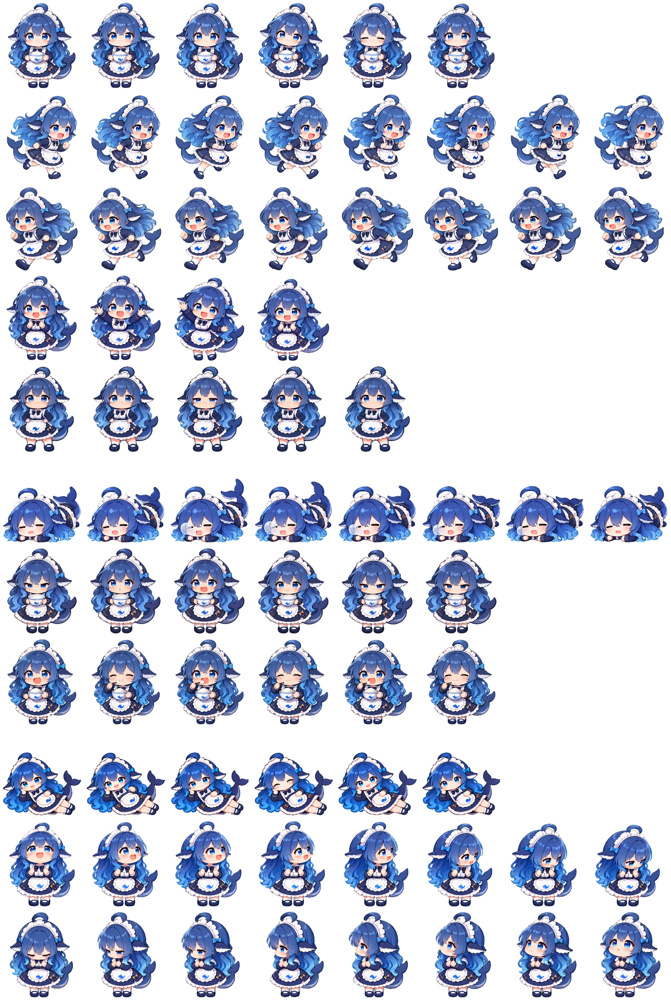
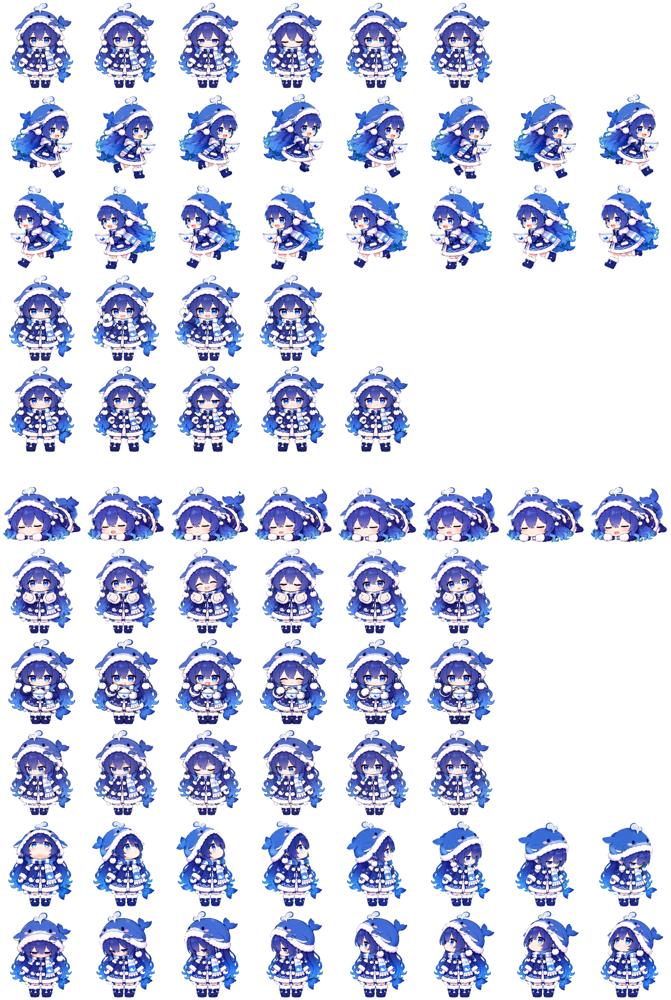

# 蓝色大肥鱼 Codex Pets

> 我是吃白饭的蓝色大肥鱼！

女仆装与冬装两只大肥鱼，可以分别安装，也可以同时保留。

| 目录 | 桌宠名称 | 设定 |
|---|---|---|
| `deepseek/` | DeepSeek | 女仆装；捧碗待机、叉腰挺胸、奔跑、吃白饭和趴睡 |
| `deepseek-winter/` | 冬装蓝色大肥鱼 | 鲸鱼毛绒帽、蓝白围巾和冬衣；空手待机、叉腰挺胸、端碗奔跑、吃白饭、冬装趴睡，以及任务完成时闭眼抬头的小得意动作 |

两只都包含 16 个视线方向，会跟着鼠标看过去。

## 鱼图预览

### 女仆装 · DeepSeek

<p align="center">
  
</p>

### 冬装 · 冬装蓝色大肥鱼

<p align="center">
  
</p>

## 安装

从 [最新 Release](https://github.com/Zhehao-w/codex-pet-pangpangFISH/releases/latest) 下载需要的安装包：

- [deepseek.zip](https://github.com/Zhehao-w/codex-pet-pangpangFISH/releases/latest/download/deepseek.zip)：女仆装。
- [deepseek-winter.zip](https://github.com/Zhehao-w/codex-pet-pangpangFISH/releases/latest/download/deepseek-winter.zip)：冬装。
- [SHA256SUMS](https://github.com/Zhehao-w/codex-pet-pangpangFISH/releases/latest/download/SHA256SUMS)：两个 ZIP 的 SHA256 校验值。

将 ZIP 内的宠物文件夹解压到 `~/.codex/pets/`。也可以克隆本仓库，将 `deepseek/` 和 `deepseek-winter/` 文件夹复制过去。

```text
~/.codex/pets/
├── deepseek/
│   ├── pet.json
│   └── spritesheet.webp
└── deepseek-winter/
    ├── pet.json
    └── spritesheet.webp
```

完全退出并重新打开 Codex，在宠物选择器中选择 **DeepSeek** 或 **冬装蓝色大肥鱼**。更新同 ID 的旧版本时，替换对应目录中的两个文件后重启 Codex。

下载两个 ZIP 和 `SHA256SUMS` 后，可在下载目录执行：

```bash
shasum -a 256 -c SHA256SUMS
```

## 仓库结构与文件

```text
.
├── README.md
├── deepseek/
│   ├── pet.json
│   └── spritesheet.webp
└── deepseek-winter/
    ├── pet.json
    └── spritesheet.webp
```

每个宠物目录只包含两个文件：`pet.json` 保存名称、描述和 V2 配置；`spritesheet.webp` 是包含全部动画帧和观察方向的透明鱼图。

两只均采用 Codex Hatch Pet V2：1536 × 2288 像素、8 列 × 11 行、单格 192 × 208 像素，`spriteVersionNumber: 2`。

## 同人作品声明

本项目是非官方、非商业的同人桌宠，仅用于个人桌面定制与技术学习。本项目与 DeepSeek、OpenAI 或 Codex 无隶属或授权关系，名称、标识及相关形象的权利归各自权利人所有。
